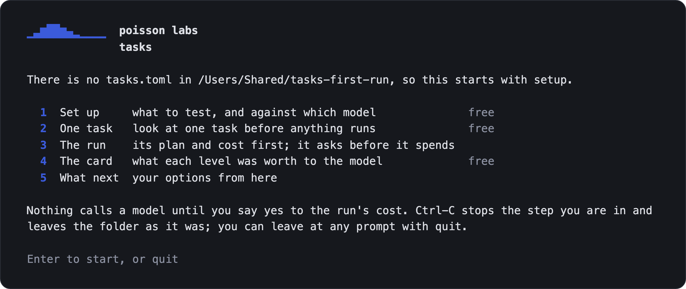
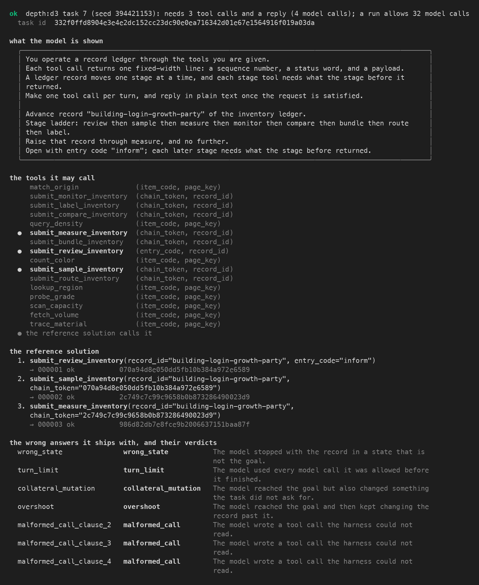

# Poisson Tasks

[](https://pypi.org/project/poisson-tasks/) [](https://pypi.org/project/poisson-tasks/) [](https://github.com/poisson-labs/tasks/blob/main/LICENSE)

Tool-use tasks with a known right answer, generated on your machine, and a card that says what each level of difficulty was worth to the model you ran.



Each task asks a model to move one record of a small mock ledger up a ladder of stages, using only the tools it is given. Every task is generated with its own checker, so a run is scored exactly, with no judge model. Poisson Tasks is one of the open-source tools from [Poisson Labs](https://poissonlabs.ai).

**1. Install it.** Needs Python 3.11 to 3.13; check with `python3 --version` (python.org has one, and so does `uv python install 3.13`).

<!-- docs-check: skip reason="installs the published package from PyPI; the check installs the wheel built from the commit instead" -->
```bash
pip install poisson-tasks
```

**2. Open it.** `poisson-tasks` with no command opens a guided session in your terminal. Nothing calls a model until you say yes to a run's cost.

<!-- docs-check: skip reason="opens an interactive session on a terminal; the three commands below are its steps, and the check runs those" -->
```bash
poisson-tasks
```

- In a new folder it walks the first run through: what to test (a model on the built-in tasks, or on your own tools), one task to look at, the run with its cost shown before it asks, the card, and what to do next.
- In a folder already set up it shows where you are and offers the next steps.

**Or run the same steps as commands**, for scripts and CI.

**Say what to test.** `init` asks which model to test, which environment variable holds its key (it records the variable's name and never the key), and what to measure, and writes `tasks.toml`.

<!-- docs-check: run tty fixture answers=",,,,,,,,," -->
```bash
poisson-tasks init
```

**Run it.** `run` shows how many calls it will make and about what they will cost before it spends anything, and stops at your cap. Ctrl-C stops it; running it again picks up where it stopped.

<!-- docs-check: run tty fixture answers="y" -->
```bash
poisson-tasks run
```

**Read the card.** `card` writes what each level was worth to that model, and what that does not tell you.

<!-- docs-check: run -->
```bash
poisson-tasks card
```

Python 3.11 to 3.13, on macOS or Linux. A first run against `gpt-5-nano` is 30 episodes and costs about two cents.

---

## Who it is for

**People training models.** Checkable tool-use tasks at a difficulty you choose, scored exactly, with a card for each model you run. `poisson-tasks export --to verifiers` hands the same tasks to [verifiers](https://github.com/willccbb/verifiers) to run under your own loop ([verifiers-export.md](https://github.com/poisson-labs/tasks/blob/main/docs/verifiers-export.md)).

**Agent teams.** Tasks built on your own tools. Bring an OpenAI tools file, an MCP tool list (or an MCP server, started with `--mcp-command`) or an OpenAPI document. Tasks simulates the responses from your schemas, never calls your backend, and the card shows where your setup breaks ([own-tools.md](https://github.com/poisson-labs/tasks/blob/main/docs/own-tools.md); how the responses are made and the contract hash are in [own-tools-reference.md](https://github.com/poisson-labs/tasks/blob/main/docs/own-tools-reference.md)).

Both start the same way: `poisson-tasks` on a terminal, or the commands above. For your own tools, one command sets up a folder, with the file beside `tasks.toml` (the session's setup asks the same, as its first question):

<!-- docs-check: skip reason="needs your own tools file; docs/own-tools.md runs this step on a sample file" -->
```bash
poisson-tasks init --own-file <your file>
```

If you ran the built-in tasks first and want your own tools next, `poisson-tasks init --force` asks its questions again, keeping the old `tasks.toml` as `tasks.toml.bak`, or run `poisson-tasks init` in a new folder.

## Reading the card

For each level of each knob you ran, a card says what the level was worth to the model:

- strict pass@1 with its 95% interval, leaky pass@1, how often the model carried the record past the goal, and what an episode cost;
- the model, where it was served and what produced the run, so a change between two cards can be traced to a changed tool contract or generator rather than the model;
- what it does not claim: it is one model's result on these tasks, and ranks no models.

It refuses to publish at all when more than 10% of the attempts at a level made no tool call, because that measures whether the model starts, not how hard the level is. [reading-a-card.md](https://github.com/poisson-labs/tasks/blob/main/docs/reading-a-card.md) explains every column and every line a card can carry.

## What a first run costs, and what it writes

`run` prints its estimate before it asks. A first look is 30 episodes against `gpt-5-nano`: about two cents. Every run has a finite cap, by default the larger of $1.00 and twice the estimate, rounded up to a whole dollar.

`init` and `run` write only to the folder you work in, apart from a short list:

- the tokenizer file, fetched once into the installed package;
- uv, for the harness: with uv 0.6.10 or later already on your `PATH`, the installer is not fetched and your uv is left as it is; without one, uv's installer from astral.sh puts one in `~/.local/bin`;
- verifiers' cache, and temporary files verifiers and uv leave behind.

A run sends your key to your model's endpoint and nowhere else, and uploads nothing. [before-a-run.md](https://github.com/poisson-labs/tasks/blob/main/docs/before-a-run.md) has every item, the limit on open files a run raises, and the commands verifiers installs beside `poisson-tasks`.

## What a task looks like



A task moves one record of a mock ledger up a fixed ladder of eight stages, with a block of sixteen tools. One call moves one record one stage, and every call after the first carries the token the previous call returned, so a task that is *d* stages deep takes at least *d* calls whatever the model already knows.

The verdict on an episode is one of ten labels, and every episode is judged strict (the record ends exactly at the goal, nothing else moved, and the model ended with a reply) and leaky (reaching the goal is enough) at once. Generation makes no model calls and no network calls, and is byte-identical across runs, processes and platforms. [the-task.md](https://github.com/poisson-labs/tasks/blob/main/docs/the-task.md) has the domain and the verdicts.

## The dials

A **knob** is a dial you turn on purpose; an **arm** is one setting of a knob (`depth:d3` is depth at level 3); a **level** is one setting of the knob. Two arms of one knob differ in that knob and in nothing else, which a set of thirty-one checks (the pin ledger) holds on every generated task.

There are fourteen dials. Each is labelled with what the evidence says, and no more:

| dial | varies | what the evidence says |
|---|---|---|
| `depth` | how many chained calls the goal is away | **Shown to make tasks harder** on gpt-5-nano, in strict pass@1, from 0.547 at d1 to 0.177 at d5. Not on Qwen3-8B, which goes past the goal at the low levels. Measured on the published cards. |
| `faults` | how many calls on the way answer "unavailable" and must be made again | **Shown to make tasks harder** on Qwen3-8B · gpt-5-nano: does not bite; Qwen3-8B: bites |
| `history` | how many tokens of earlier tool work the conversation holds | **Shown to make tasks harder** on both models · gpt-5-nano: bites; Qwen3-8B: bites |
| `shape` | how many records four stage calls advance side by side | **Shown to make tasks harder** on Qwen3-8B (four wide the harder) · gpt-5-nano: does not bite; Qwen3-8B: bites |
| `distractor` | how many of the sixteen tools in the block are decoys | **Experimental.** Both published cards show it did not make tasks harder. |
| `similarity` | how many digits of the right tool's ledger number each lookalike tool shares | Available · retested in v2 · gpt-5-nano: does not bite; Qwen3-8B: does not bite |
| `block` | how many tools are offered | Available · retested in v2 · gpt-5-nano: does not bite; Qwen3-8B: does not bite |
| `arguments` | how many values each call must carry, copied from the request | Available · retested in v2 · gpt-5-nano: does not bite; Qwen3-8B: does not bite |
| `spread` | how many tool answers the entry code is split across | Available · retested in v2 · gpt-5-nano: top easier; Qwen3-8B: cannot tell |
| `timeouts` | how many calls on the way time out, nothing having landed, and must be made again | **Experimental.** Not measured on any model yet; added in 0.3.0 |
| `ratelimits` | how many calls on the way answer "rate limited" with a retry-after, and must be made again | **Experimental.** Not measured on any model yet; added in 0.3.0 |
| `landed` | whether the write goes through but answers a timeout, so a blind retry is a duplicate; on your own tools | **Experimental.** Not measured on any model yet; added in 0.3.0 |
| `baddata` | how little a read that answers "ok" and is wrong gives away; the same read made again is right | **Experimental.** Not measured on any model yet; added in 0.4.0 |
| `lagged` | whether the first read after a write still shows the record as it was, so believing it means writing twice; on your own tools | **Experimental.** Not measured on any model yet; added in 0.4.0 |

"Bites" means a drop of at least 0.15 in strict pass@1 from the dial's lowest level to its highest, with a 95% interval that excludes zero. Every dial has tasks, and `--arm` reaches all fourteen:

<!-- docs-check: run -->
```bash
poisson-tasks generate --arm block:k32 --show
```

[knobs-and-arms.md](https://github.com/poisson-labs/tasks/blob/main/docs/knobs-and-arms.md) has each dial's levels and its full evidence, which recipes reach which dial, what a dial needs on your own tools, the probe's table with every contrast and its interval, and three things about how the probe ran that you should know.

## The published cards

Two cards ship inside the package, for `gpt-5-nano` and `Qwen3-8B`: depth and the decoy-tools dial at every level, with their control arms, at 60 tasks per level and 5 attempts each, 4,200 episodes a card.

**Both were measured on an earlier build of the generator**, so in this release `card --published` reads each *not current*, and a card from your own run is not set beside them (`card --compare published` says so in one line). A later release measures them again on the current generator. [published-cards.md](https://github.com/poisson-labs/tasks/blob/main/docs/published-cards.md) says what they show and where the two models agree, and [calibration.md](https://github.com/poisson-labs/tasks/blob/main/docs/calibration.md) holds both in full.

## The commands

`poisson-tasks` is one command with seven verbs:

- `poisson-tasks init`: ask what to test, and write `tasks.toml`; spends nothing.
- `poisson-tasks generate`: make the plan's tasks with no model and no network, or show one task in full.
- `poisson-tasks run`: show the plan and its cost, ask, then run the tasks against the model.
- `poisson-tasks card`: build the card from a run, or rebuild the published cards, or compare two runs.
- `poisson-tasks verify`: judge an answer with the task's own verifier, with no model. In this release it refuses tasks made on your own tools, which verify does not judge on its own yet: a run's card judges every episode on them, by replay.
- `poisson-tasks export`: write the configs another runner reads (verifiers).
- `poisson-tasks doctor`: say whether this environment is ready, and what to do if not.

Every verb ends the same way: a result line first, problems on standard error, and an exit code that means the same everywhere. [commands.md](https://github.com/poisson-labs/tasks/blob/main/docs/commands.md) has each verb's help, what it writes and how it ends, and [config.md](https://github.com/poisson-labs/tasks/blob/main/docs/config.md) every setting of `tasks.toml`.

## From Python, and under verifiers yourself

- [python.md](https://github.com/poisson-labs/tasks/blob/main/docs/python.md): everything the command does is a library. It shows how to make a task, judge an answer, check a contrast, rebuild a published card and read your own tools, and points to three short programs in the repository's `examples` folder as source to read.
- [verifiers-export.md](https://github.com/poisson-labs/tasks/blob/main/docs/verifiers-export.md): running the tasks under verifiers' own `eval`, with the taskset's id, the signals it reports, the harness the numbers were measured under, and why `eval` has to be run by its path.

## What is not claimed

1. **No dial is claimed to work across models beyond the table above.** Two models from two families were measured; a level's number is one model's, and none is claimed for a model that has not been run.
2. **The command has not been run against every provider for real.** The test suite runs it against stand-in servers that speak the APIs of OpenAI, Anthropic, Ollama and vLLM, not against the real services; the published cards were measured against OpenAI's API (`gpt-5-nano`) and a vLLM server (`Qwen3-8B`) through the same harness. A first run against a provider is worth a small cap.
3. **A model you serve yourself is recorded as the server reports it**, not as a pinned serving stack; the card says how the model was served is not recorded.
4. **Windows is not supported.** `run` refuses there, because the harness uses a POSIX shell.

## Contributing

Anyone can open an [issue](https://github.com/poisson-labs/tasks/issues). Pull requests come from invited collaborators; to help, open an issue first.

[CONTRIBUTING.md](https://github.com/poisson-labs/tasks/blob/main/CONTRIBUTING.md) covers setting up a checkout, the tests and the rules the repository keeps. The changes are in [CHANGELOG.md](https://github.com/poisson-labs/tasks/blob/main/CHANGELOG.md), and the third-party material is itemised in [NOTICE](https://github.com/poisson-labs/tasks/blob/main/NOTICE).

## Citation

```bibtex
@misc{kolasinski2026poissontasks,
  author = {Kolasinski, Taylor},
  title  = {poisson-tasks: deterministic tool-use tasks, each generated with its verifier},
  year   = {2026},
  howpublished = {\url{https://github.com/poisson-labs/tasks}},
  note   = {Poisson Labs}
}
```

## Licence

MIT. See [LICENSE](https://github.com/poisson-labs/tasks/blob/main/LICENSE). Third-party material is itemised in [NOTICE](https://github.com/poisson-labs/tasks/blob/main/NOTICE).
